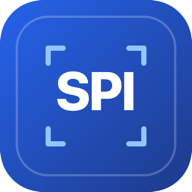

<p align="center">
  
</p>

# spi-camera-solver

iPhoneのカメラでSPIの選択問題を撮影すると画像をバックエンド経由でGemini APIへ自動送信し、正答候補と簡潔な理由を表示する個人専用PWAです。ローカル環境（PC＋同じWi-Fi内のiPhone）でも、Cloudflare Workers Freeを使った個人専用サーバー（PCの電源を切って外出先から利用）でも動かせます。

開発者: [`@haruto20041019-hash`](https://github.com/haruto20041019-hash)

## 主要機能

- 背面カメラを `getUserMedia`（`audio: false`）で起動し、撮影ボタンを押した瞬間に `<canvas>` から静止画を取得します（アプリ自身はシャッター音を鳴らしませんが、OSや端末仕様による撮影音制約の回避は保証しません）。
- iOSで別アプリへ切り替えたり画面をロックしたりしたあとにカメラが停止した場合は、ページ表示イベントと映像トラック終了イベントを検知して自動でカメラ再起動を試みます。
- 1回の撮影につき原則1回のAPI呼び出しで設問と全選択肢を読み取り、`gemini-3.8-flash`（`GEMINI_THINKING_LEVEL=high`）で正答候補と理由、計算問題の検算結果を表示します。
- ぼやけや見切れで判読できない画像は無理に解答せず「読み取れませんでした」と表示して再撮影を促します。
- 撮影した画像や解答履歴のデータベース保存・ストレージ永続化は行いません。
- Cloudflare Workers公開時はCloudflare AccessとWorker内のRS256 JWT署名検証によって許可した本人のメールアドレスだけを通過させます。`ALLOWED_EMAIL`、`CF_ACCESS_TEAM_DOMAIN`、`CF_ACCESS_AUD` のいずれかが未設定の場合はHTTP `403` で全アクセスを拒否します。

## 画面構成

本リポジトリにはUIのスクリーンショット画像は同梱していないため、実機の画面構成を以下にまとめます（アプリアイコンには上部の `./public/icon-192.png` を使用しています）。

| 画面 | 表示内容と操作 |
|---|---|
| 1. カメラ画面 | 背面カメラのリアルタイム映像、撮影ガイド枠、右上解像度バッジ（`無音Canvas / 1920×1080` など）、下部の「撮影して解答」ボタン |
| 2. 解析中表示 | 撮影した静止画の背景とスピナー、「解答を解析中...」のメッセージ、「キャンセルして戻る」ボタン |
| 3. 解答・解説画面 | 最上部に「正答候補」（選択肢記号と値）と確度バッジ、その下に「理由・解説」「検算・根拠確認」「認識した問題」、下部に「次の問題を撮影（再撮影）」ボタン |

## 利用料金と契約条件に関する注意

本アプリでは利用者自身のGemini APIキーとCloudflareアカウントを使用します。無料枠の上限、有料枠での課金単価、レート制限、請求設定（オートチャージの有無など）は各自のGoogle AI Studio / Google CloudおよびCloudflareの契約条件に従います。意図しない課金を防ぐため、セットアップ時に各自でGoogle Cloud側の請求設定とCloudflareのプランが無料枠のままになっているかを確認してください。本アプリには利用料金の計算機能や表示機能は含まれていません。

## 事前準備

手元のPC（macOS / Linux / Windows）に以下を用意します。

1. Node.js 20以上とnpm（[Node.js公式サイト](https://nodejs.org/)からLTS版を導入）
2. Git
3. OpenSSL（ローカルHTTPSテスト用の自己署名証明書生成スクリプト `scripts/ensure-cert.mjs` が使用します。macOSには標準またはHomebrewで入っています）
4. Googleアカウント（Gemini APIキー取得用）
5. Cloudflareアカウント（外出先からMacなしで使いたい場合のみ。無料プランで足ります）

---

## ステップ1: Gemini APIキーの取得

1. ブラウザで [Google AI Studio](https://aistudio.google.com/apikey) を開き、ご自身のGoogleアカウントでログインします。
2. 「APIキーを作成」（Create API key）を選択し、新しいAPIキーを発行して手元に控えます。
3. 発行画面やGoogle Cloud側の請求設定で、現在のプロジェクトが無料枠（Free tier）か従量課金かを確認します。無料運用のまま使いたい場合はオートチャージや有料請求が有効になっていないか確認してください。

---

## ステップ2: ローカル環境での起動（同じWi-FiのiPhoneから試す）

最初に手元のPC上で動かし、カメラ撮影からGeminiの解答表示まで確認します。

1. リポジトリを取得してプロジェクトディレクトリへ移動し、依存パッケージをインストールします。

   ```bash
   git clone https://github.com/haruto20041019-hash/spi-camera-solver.git
   cd spi-camera-solver
   npm install
   ```

2. `.env.example` をコピーして `.env` を作成します。

   ```bash
   cp .env.example .env
   ```

3. 作成した `.env` をテキストエディタで開き、`your_gemini_api_key_here` の部分をステップ1で取得したご自身のGemini APIキーに書き換えて保存します。

   ```dotenv
   GEMINI_API_KEY=AIza...（ご自身のAPIキーに書き換えてください）
   GEMINI_MODEL=gemini-3.8-flash
   GEMINI_THINKING_LEVEL=high
   PORT=3001
   ```

   `.env` ファイルは `.gitignore` に登録されているためGitには含まれません。

4. 開発サーバーを起動します。

   ```bash
   npm run dev
   ```

   初回起動時に `scripts/ensure-cert.mjs` が `.cert/` 配下へ自己署名HTTPS証明書を自動生成し、Node.jsバックエンド（`127.0.0.1:3001`）とVite開発サーバー（HTTPS `5173`）が起動します。ターミナルに以下のようなURLが表示されます。

   ```text
   [ensure-cert] iPhone実機テスト用URL:
     https://192.168.x.x:5173
   ```

5. iPhoneをPCと同じWi-Fiに接続し、iPhoneのSafariで表示された `https://192.168.x.x:5173` を開きます。
6. 自己署名証明書のため「この接続ではプライバシーが保護されません」と表示されます。「詳細を表示」をタップし、「このWebサイトを閲覧」をタップして進みます。
7. カメラへのアクセス許可ダイアログが出たら「許可」をタップし、手元のSPI問題を1問撮影して解答と理由が表示されることを確認します。

ローカル環境でカメラが起動しない場合は、PCの `.cert/cert.pem` をAirDropなどでiPhoneに送り、「設定」→「一般」→「VPNとデバイス管理」からプロファイルをインストールしたあと、「設定」→「一般」→「情報」→「証明書信頼設定」で該当証明書をオンにするとHTTPS通信が信頼されます。

---

## ステップ3: Cloudflare Workers Free の準備（Macなしで使う場合）

PCの電源を切った状態でもiPhoneから使えるようにするため、ご自身のCloudflare無料アカウントへアプリを配置します。

1. [Cloudflareダッシュボード](https://dash.cloudflare.com/) にログイン（または新規アカウント作成）します。
2. 左メニューの「Workers & Pages」（または「Compute (Workers)」）を開きます。プラン選択が出た場合は必ず「Workers Free」を選び、有料の「Workers Paid」には変更しないでください。
3. 画面右側または初期設定画面で `workers.dev` サブドメインを1つ決めて登録します（例: `<あなたのサブドメイン>.workers.dev`）。

---

## ステップ4: Zero Trust Free と One-time PIN による本人認証設定

APIキーを守るため、Cloudflare Accessであなた自身のメールアドレスだけを通過させる鍵をかけます。`wrangler.toml` ではプレビューURLを無効（`preview_urls = false`）にしています。

1. Cloudflareダッシュボードの左メニューから「Zero Trust」を開きます。
2. 初回はチーム名（任意の英数字）の入力とプラン選択が表示されます。必ず **Zero Trust Free（$0）** を選んで初期設定を完了してください。
3. 左メニューの「Settings」→「Authentication」→「Login methods」を開き、「One-time PIN」が一覧に登録されていることを確認します（なければ「Add new」から「One-time PIN」を追加します）。
4. 同じ画面の「Settings」→「Custom Pages」または上部に表示される **Team domain**（`<チーム名>.cloudflareaccess.com`）を控えます。
5. 次に、公開するWorkerをAccessで保護します。方法は次のどちらか一方を選んでください。

   - 方法1（推奨・手軽）: 「Workers & Pages」概要画面にある「Protect all Workers」カード（または個別Workerの「Access」タブ）から「Enable Access」を押し、スコープで **All traffic** を選びます。ポリシーは「Allow」にし、Include で「Emails」を選んで **ご自身のメールアドレス1件だけ** を登録します。
   - 方法2（URL指定）: 「Zero Trust」→「Access」→「Applications」→「Add an application」→「Self-hosted」を開きます。Application domain に `spi-camera-solver.<ステップ3のサブドメイン>.workers.dev` を入力し、Policiesで「Allow」・Include「Emails」にご自身のメールアドレス1件だけを登録します。

6. 作成したAccess設定の **Login methods**（ログイン方法）を開き、**One-time PIN** が有効になっていることを確認して保存します（初期状態で「Cloudflare」のみがオンになっているとiPhone SafariでOAuth認証リダイレクトが失敗しやすいため、One-time PINを有効にしておくのが安全です）。
7. 作成したAccessアプリ画面に表示される **Application Audience (AUD) Tag**（長い英数字文字列）をコピーして控えます。方法1を使ってAUDタグが画面で見つけにくい場合は、ステップ5のデプロイ後にトラブルシューティング欄の `curl -sI` コマンドで確認できます。

---

## ステップ5: `wrangler.toml` の設定・Secrets登録・デプロイ

1. プロジェクト直下の `wrangler.toml` を開き、`[vars]` の空欄3か所をご自身の値に書き換えて保存します。

   ```toml
   [vars]
   GEMINI_MODEL = "gemini-3.8-flash"
   GEMINI_THINKING_LEVEL = "high"
   ALLOWED_EMAIL = "your-email@example.com"
   CF_ACCESS_TEAM_DOMAIN = "your-team.cloudflareaccess.com"
   CF_ACCESS_AUD = "your-application-aud-tag"
   ```

   3つのうち1つでも空欄のままだと、`worker/index.mjs` のFail-Closed設計により本番アクセスがすべてHTTP `403` で拒否されます。

2. WranglerでCloudflareアカウントにログインします。コマンド実行後にブラウザが開くので「Allow」をクリックします。

   ```bash
   npx wrangler login
   ```

3. Gemini APIキーをCloudflare Secretsに登録します（コードや `wrangler.toml` には書かず、暗号化されたSecretsとして保存します）。

   ```bash
   npm run cf:secret:key
   ```

   入力プロンプトが表示されたら、ステップ1で取得したGemini APIキーを貼り付けてEnterを押します。

4. ビルドとCloudflare Workersへのデプロイを実行します。

   ```bash
   npm run cf:deploy
   ```

   成功すると最後に以下のような本番URLが表示されます。

   ```text
   https://spi-camera-solver.<あなたのサブドメイン>.workers.dev
   ```

デプロイ後、別のスマホやシークレットウィンドウなど未認証の状態でこのURLを開き、Cloudflare Accessのログイン画面へリダイレクトされること（他人には一切使えないこと）を確認してください。

---

## ステップ6: iPhoneのホーム画面への追加と使い方

1. iPhoneの **Safari** で `https://spi-camera-solver.<あなたのサブドメイン>.workers.dev` を開きます。
2. Cloudflare Accessのログイン画面が出たら、許可したご自身のメールアドレスを入力します。
3. 届いたメールに記載されている6桁の確認コード（One-time PIN）を入力してログインします。
4. アプリのカメラ画面が開いたら、Safari下部メニューの共有ボタン（四角に上向き矢印）をタップし、「ホーム画面に追加」→「追加」を選びます。
5. ホーム画面に「SPI解答」アイコンが追加されます。アイコンから起動し、カメラ使用許可を出せば以降はMacの電源を切っていてもワンタップで利用できます。

---

## Cloudflare Access 関連のトラブルシューティング

| 症状・エラー | 原因 | 解決方法 |
|---|---|---|
| 「Sign in with: Cloudflare」しか出ずログインできない・ループする | Accessのログイン方式がCloudflareアカウントOAuthのみになっており、iPhone Safariのプライバシー制限や検証エラーで止まっている | Zero Trust → Settings → Authentication → Login methods で「One-time PIN」を追加し、対象Accessアプリ側のLogin methodsでもOne-time PINを有効にします。一時的に解決したい場合はiPhone「設定」→「Safari」→「サイト越えトラッキングを防ぐ」をオフにして通常タブでログインしてください。 |
| 6桁コードのメールリンクを踏むとエラーになる | メールアプリのセキュリティスキャンが認証リンクを先に踏んで使用済みになっている | メール内のリンクはクリックせず、本文に書かれている6桁の数字コードをSafariの入力欄へ直接入力してください。 |
| `認証設定が不完全なためアクセスを拒否しました`（HTTP 403）が出る | `wrangler.toml` の `ALLOWED_EMAIL`、`CF_ACCESS_TEAM_DOMAIN`、`CF_ACCESS_AUD` のいずれかが空欄 | 3つすべてを正しく記入し、`npm run cf:deploy` を再実行してください。 |
| `CF_ACCESS_AUD` や `CF_ACCESS_TEAM_DOMAIN` が分からない | Protect all Workers を使ったためZero Trust画面でAUDを見つけにくい | 一度デプロイしたあとPCで `curl -sI https://spi-camera-solver.<サブドメイン>.workers.dev/` を実行し、`location:` ヘッダーを確認します。`https://<チーム名>.cloudflareaccess.com/...?kid=<ここがAUDタグ>` から両方の値を読み取れます。値を `wrangler.toml` に記入して再度 `npm run cf:deploy` を実行してください。 |
| `許可されていないアカウントからのアクセスです`（HTTP 403）が出る | Accessでログインしたメールアドレスと `wrangler.toml` の `ALLOWED_EMAIL` が一致していない | `ALLOWED_EMAIL` とAccessポリシーに登録したメールアドレスを大文字・小文字含め同じアドレスに揃え、`npm run cf:deploy` を実行してください。 |
| `Cloudflare Secrets に GEMINI_API_KEY を設定してください`（HTTP 400）が出る | `GEMINI_API_KEY` がCloudflare Secretsに登録されていない | `npm run cf:secret:key` を実行し、Gemini APIキーを貼り付けて登録してください。 |
| しばらく使うと「認証セッションの確認が必要です。ページを再読み込みしてログインしてください。」と出る | Cloudflare Accessのセッション有効期限が切れている | 表示されている「ページを再読み込み」ボタンを押し、One-time PINで再認証してください。 |

---

## 利用可能なnpmスクリプト一覧

| コマンド | 内容 |
|---|---|
| `npm run dev` | ローカルHTTPS証明書を生成し、NodeバックエンドとViteフロントエンドを同時起動 |
| `npm run dev:server` | ローカルNodeバックエンド（`server/index.mjs`）のみ起動 |
| `npm run dev:client` | ローカルHTTPS証明書を生成し、Viteフロントエンドのみ起動 |
| `npm run build` | TypeScriptの型チェックとViteの本番ビルド（`dist/` 出力） |
| `npm run preview` | ビルド済み `dist/` をHTTPSでプレビュー配信 |
| `npm run cf:dev` | ビルド後に `wrangler dev` でWorkersローカル動作確認 |
| `npm run cf:secret:key` | `GEMINI_API_KEY` をCloudflare Secretsに登録 |
| `npm run cf:deploy` | ビルド後にCloudflare Workersへ本番デプロイ |

---

## ライセンスと著作権表示

本プロジェクトは MIT License のもとで公開しています。商用利用、改変、再配布が可能です。詳細は [LICENSE](./LICENSE) を参照してください。

背面カメラの取得処理、Canvasによる静止画抽出、Gemini APIの `inlineData` 送信構造は、MIT License で公開されている [gaurav-chhajer/Be-My-Eyes](https://github.com/gaurav-chhajer/Be-My-Eyes)（Copyright (c) [2025] GAURAV CHHAJER）の実装を参考にして構成しました。
